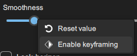
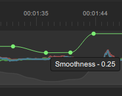
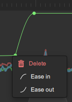
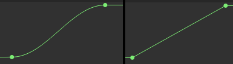

# 🔑 Keyframes

Most parameters in Gyroflow can be keyframed - meaning their value can be changed in different parts of the video (i.e. you can use a different smoothness at the start of the video, compared to the end).

## How to use?

### Enabling keyframes

Keyframes can be enabled by right-clicking on the slider and choosing **Enable keyframing.**

<figure><figcaption></figcaption></figure>

Then, go to a time in the video when you want the value to be different and just change the slider value. This will create a keyframe on the timeline chart.

<figure><figcaption>
Smoothness keyframe
</figcaption></figure>

### Keyframe easing

You can right-click the keyframe point to change its easing:

* **Smooth** - the value follows a smooth curve through the neighbouring keyframes, without overshooting, instead of slowing to a stop at each keyframe. Since Gyroflow 1.7.0, it's the default for new keyframes.
* **Ease in** and/or **Ease out** - the value slows down when it arrives at the keyframe and/or when it leaves it.
* With none of them checked, the value changes linearly.

<figure><figcaption></figcaption></figure>

<figure><figcaption>
Ease in + out vs. linear keyframe
</figcaption></figure>


Projects with **Smooth** keyframes will load without any keyframes in Gyroflow 1.6.x and older.


You can jump to the previous or next keyframe with **Shift+Page Up** and **Shift+Page Down** (or **Shift+Left** and **Shift+Right**), or by Shift+clicking the previous/next frame buttons below the video.

### Removing/disabling keyframes

You can right-click the keyframe point to delete it, or to disable all keyframing for a slider, right-click on the slider and uncheck **Enable keyframing** - this will clear all keyframes on that slider.

## Keyframeable parameters

* Smoothness
* FOV
* Zooming speed
* Zoom limit
* Horizon lock amount / roll correction
* Horizon lock pitch angle (since Gyroflow 1.7.0)
* Lens correction strength
* Lens is under water
* Additional 3D rotation
* Max smoothness
* Max smoothness at high velocity
* Pitch/Roll/Yaw smoothness
* Video rotation
* Background margin / feather
* Video speed

## Example



## Caveat

The **Gaussian filter** zooming method may show black borders when the zooming speed is keyframed. When you enable keyframing of the zooming speed, Gyroflow switches the zooming method to **Envelope follower**, and shows a warning if you switch it back.
