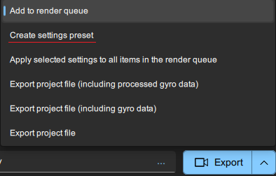
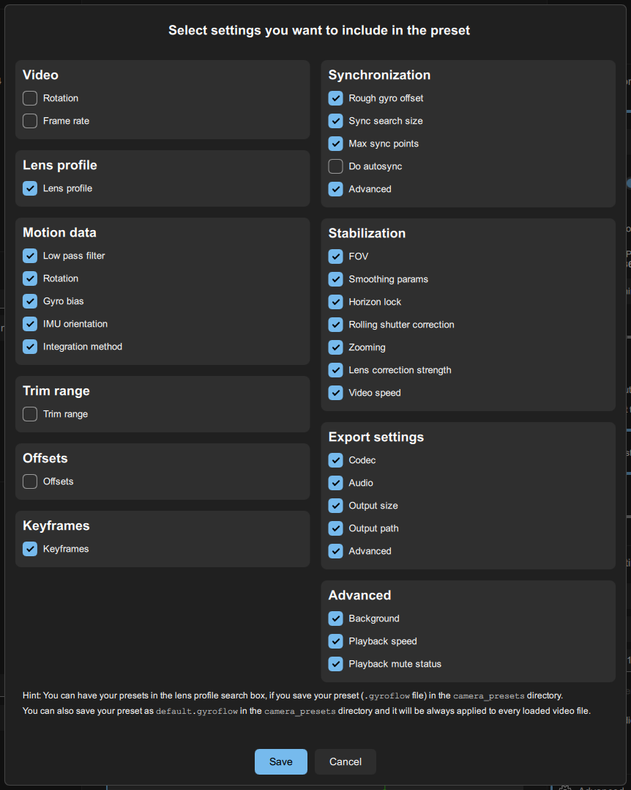
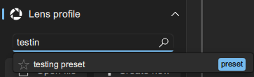

# ⚙ Settings presets

Presets can be used to store your common preferred settings in the UI. You can then have them in the Lens profile search box, or you can drag &  drop them in the UI or in the [render queue](render-queue.md), or use in the [CLI](command-line-cli.md).

## Creating presets

In order to create a preset, set any settings you want in the UI, then click on the arrow on the **Export** button and choose **Create settings preset.**

<figure><figcaption></figcaption></figure>

Then simply select settings you want to include in the preset:

<figure><figcaption></figcaption></figure>

Since Gyroflow 1.7.0, the preset dialog also has the **Disable lens stretch (for plugins)** option. Use it when your video editor does the anamorphic desqueeze itself: the [video editor plugins](../video-editor-plugins/general-plugin-workflow.md) then don't apply the input stretch from the lens profile again.

At the bottom of the dialog, choose where to save the preset:

* **Save to file** - anywhere you want. You can then drag & drop it in the UI or in the render queue.
* **Save to lens profile directory** - the preset shows up in the Lens profile search box, where it can be favorited and searched.
* **Save as default preset** - see [Default preset](settings-presets.md#default-preset).

<figure><figcaption>
Preset in the lens profile search box
</figcaption></figure>


The lens profile directory is the `lens_profiles` folder in Gyroflow's data folder (`Advanced -> Open data folder`). Presets saved there aren't replaced when Gyroflow is updated.


## Default preset

The default preset (`default.gyroflow` in the lens profile directory) is loaded automatically with every video, in the main window, in the render queue and in the video editor plugins.

The old location, `default.gyroflow` in the `camera_presets` folder of the Gyroflow installation, still works, but it's replaced when Gyroflow is updated, and the one in the lens profile directory takes precedence.
