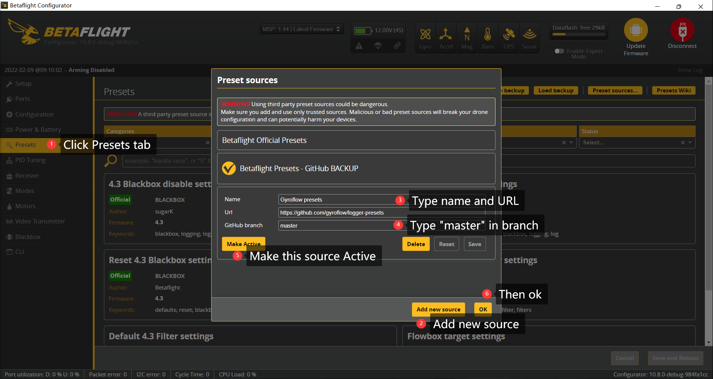
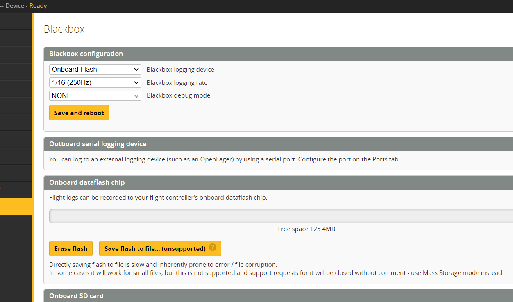

# Flight controller

Betaflight/Cleanflight/Inav/Emuflight/etc form a popular family of flight control firmware for high-performance multicopters. By using the built-in blackbox logging feature, gyro data for use with Gyroflow video stabilization can be collected. This was in fact one of the initial goals of the project! Betaflight, Cleanflight, Inav, Emuflight etc. all use more or less the same structure for handling blackbox data logging, so this page covers all of these.

### Hardware <a href="#hardware" id="hardware"></a>

As you may already know, the above mentioned flight firmwares can all run on the same type of hardware. A flight controller supporting this family of flight firmwares typically contain:

* STMicroelectronics 32 bit microcontroller (F4, F7, G4, H7)
* MEMS inertial measurement unit (MPU6000, BMI270, ICM2xxxx, ICM4xxxx etc.)

Some flight controllers have an onboard magnetometer. In general, this is not required for video stabilization purposes unless absolute orientation is desired.

Different gyros exhibit different behaviors in terms of data quality, noise, etc. In general, if the IMU is capable of providing clean data for the drone control loop, the same data is suitable for video stabilization purposes.

For blackbox data logging, the hardware typically either contains an onboard SPI Flash chip, or a slot for an SD card. If neither of these are available, additional hardware solutions can be connected to the flight controller in order to enable blackbox logging. This can be using:

* [The Openlager](https://github.com/d-ronin/openlager) - A open source and commercially available board containing an STM32f4 and a MicroSD slot for logging high rate data through a spare serial port.
* [Tiny Blackbox](https://github.com/alexeystn/tiny-blackbox) - An open source ultra-light logger containing a 16 MB flash chip.
* [~~SparkFun OpenLog~~](https://github.com/sparkfun/OpenLog) - A serial-based logger similar to the Openlager. This is no longer officially supported by Betaflight etc. due to data rate limitations.

### Betaflight/(Cleanflight/Emuflight?) <a href="#betaflightcleanflightemuflight" id="betaflightcleanflightemuflight"></a>

Required software:

* Betaflight/Cleanflight/Emuflight configurator
* Betaflight blackbox explorer

The following should be a decent starting point for the blackbox configuration

* 250 Hz logging rate
* Debug mode: `None`

If you're running Betaflight 4.3 or newer, it is possible to deselect specific elements of the data logging in order to save precious recording space.

### Gyroflow logger preset <a href="#gyroflow-logger-preset" id="gyroflow-logger-preset"></a>

We have a gyroflow-betaflight presets source for your convenience. You can easily set it up like the picture shown below:

<figure><figcaption></figcaption></figure>

Once the gyroflow logger preset is actived, you'll see some special gyroflow presets:

* **Gyroflow minimal settings**: for users who wanna use the blackbox data from main FC as motion data for video stabilization.
* **Sencondary FC as Gyroflow motion logger**: for users who use a secondary FC as a gyroflow motion logger.
* **Gyroflow BMI270 Filter sttings**: for users whose FC has a BMI270 sensor and want to use it as a gyroflow motion logger.
* **Flowbox target settings**: preset for flowbox and flowbox+flowshutter

#### CLI commands <a href="#cli-commands" id="cli-commands"></a>

Or you might prefer the "old fashion", from the CLI:

```
set blackbox_disable_pids = ON
set blackbox_disable_rc = ON
set blackbox_disable_setpoint = ON
set blackbox_disable_bat = ON
set blackbox_disable_mag = ON
set blackbox_disable_alt = ON
set blackbox_disable_rssi = ON
set blackbox_disable_debug = ON
set blackbox_disable_motors = ON
set blackbox_disable_gps = ON
```

<figure><figcaption></figcaption></figure>

### Camera angle <a href="#camera-angle" id="camera-angle"></a>

The flight controller is mounted flat, while the camera is usually tilted up. Enter the camera angle in `Motion data -> Rotation -> Pitch`: positive when the camera is tilted up, negative when it's tilted down. For example, for a camera tilted up 30°, enter `30`.

If the stabilization still drifts or wobbles, adjust the angle by a few degrees and compare the lines on the chart, see [🔀 IMU orientation and rotation](../imu-orientation-and-rotation.md).

### Multiple logs in one file <a href="#multiple-logs" id="multiple-logs"></a>

A blackbox file can contain several logs, e.g. one per flight. Gyroflow then shows **Select log** in the Motion data panel, where you can choose the log of your flight, or **All logs combined**.

### Acknowledgements <a href="#acknowledgements" id="acknowledgements"></a>

* [logger-presets](https://github.com/gyroflow/logger-presets): Forked from betaflight/firmware-persets
