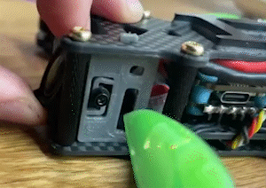
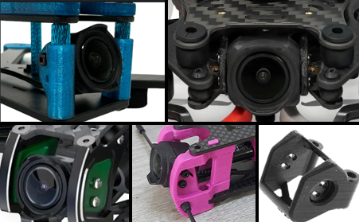

# DJI

DJI started to add gyro data to their products with the release of DJI Avata. DJI gyro data has lens profile built in and doesn't require any synchronization. It therefore works out of the box, just drag & drop the video file, click Export and you're good to go.


**Important!** In-camera stabilization (EIS/Rocksteady) needs to be **disabled**, and FOV needs to be set to **Wide.** Otherwise your camera **will not** record gyro data and won't be usable in Gyroflow.\
\
Ultrawide, Normal or "Natural Wide" lens modes are **not supported.**


## Supported models

<table><thead><tr><th width="142">Model</th><th width="111">Gyro data</th><th width="124">Lens profile</th><th width="159">Synchronization</th><th>Remarks</th></tr></thead><tbody><tr><td>Avata Avata 2</td><td>✅ </td><td>✅ Official</td><td>✅ Not needed</td><td></td></tr><tr><td>Neo Neo 2</td><td>✅ </td><td>✅ Official</td><td>✅ Not needed</td><td></td></tr><tr><td>O3 Air Unit O4 Air Unit</td><td>✅ </td><td>✅ Official</td><td>✅ Not needed</td><td>Needs to be soft-mounted, or use <a href="dji.md#dji-o3-o4-air-unit-vibration-issues">Optical correction</a></td></tr><tr><td>Action 2</td><td>✅ </td><td>✅ Official</td><td>✅ Not needed</td><td>Since firmware v01.04.0510</td></tr><tr><td>Action 3</td><td>❌</td><td>❌</td><td>❌</td><td>❌ Won't be supported</td></tr><tr><td>Action 4 Action 5 Action 6</td><td>✅ </td><td>✅ Official</td><td>✅ Not needed</td><td></td></tr><tr><td>Osmo Nano</td><td>✅ </td><td>✅ Official</td><td>✅ Not needed</td><td></td></tr><tr><td>DJI FPV</td><td>❌</td><td>❌</td><td>❌</td><td>❌ Won't be supported</td></tr><tr><td>Osmo 360 Avata 360</td><td>✅</td><td>-</td><td>-</td><td><mark style="color:yellow;">⚠️</mark> <a href="dji.md#osmo-360-and-avata-360">Motion data only</a></td></tr></tbody></table>

## Osmo 360 and Avata 360

Since Gyroflow 1.7.0, Gyroflow reads the motion data of the DJI Osmo 360 and DJI Avata 360, but it can't play their 360° video files. Open a playable copy of the clip (e.g. a transcode or a proxy) as the video, and then load the original file in **Motion data -> Open file**.

Stabilizing stitched 360° video is still not supported, see [🥽 360° cameras](../../advanced-usage/360-cameras.md).

## Exporting for DJI Mimo

DJI Mimo can show dashboard overlays (like speed or altitude) from the metadata the camera records in the video. Since Gyroflow 1.7.0, **Preserve other tracks** in `Export settings -> Advanced` copies that metadata to the stabilized video as it is, so Mimo recognizes the exported file.

Keep **Audio codec** at **AAC**: with **Copy**, the output is a .mov file, which Mimo doesn't accept.

## Split recording

DJI cameras have a file size limit of 4 GB. If the recording is longer, it will be split into multiple parts. If you want to stabilize such split video, you'll have to merge the parts before stabilization.

Gyroflow can do that for you. Just drag & drop all your files in the sequence to Gyroflow to merge.

You can find more information on the [**🎞 File joiner**](../file-joiner.md) page.

## DJI O3/O4 Air Unit vibration issues 

A common issue with the O3 Air Unit is that after stabilization, the video is more shaky than before. This happens because the camera module is very lightweight and is often hard-mounted to the drone frame, which makes it very prone to collect noise from the motors.

Try to fix the vibrations in hardware first, if you can: clean motion data always gives the best results. If you can't, use [Optical correction](dji.md#if-you-cant-fix-the-hardware-optical-correction).

### Fix the vibrations at the source

#### 1. Change the motor PWM frequency from 24 kHz to 48 kHz

The default 24 kHz PWM frequency creates interference with the IMU sampling frequency. You can adjust the motor PWM in your ESC[^1] to 48 kHz or more, to avoid this interference. For most ESC's you can use [BLHeli Suite or BLHeli Configurator](http://www.multirotorguide.com/guide/blheli-suite-and-blheli-configurator-how-to-download-install-use-blhelisuite/).

#### 2. Soft mount the camera

You should avoid hard mounting the O3 Air Unit camera to the drone frame. It needs some kind of dampening to filter out the noise from the motors. Here's a good example of a soft mounted camera:

<figure><figcaption></figcaption></figure>

Link to thingiverse: [https://www.thingiverse.com/thing:5674654](https://www.thingiverse.com/thing:5674654)

TPU or rubber inserts also work fine, here are some other examples:

<figure><figcaption></figcaption></figure>

#### 3. Make sure your lens is not loose

Some people reported that the lens of the camera unit can become loose and needs to be glued.\
If nothing else helps, chances are you also have this issue. Check out this video for explanation and details:



#### 4. Make sure your quad is properly tuned

If your quadcopter is well tuned and doesn't vibrate by it's own, it's less likely to create problems for the O3 Air Unit. Make sure you're using fresh, well-balanced propellers, your quad doesn't have resonance issues and you are using [RPM filtering](https://oscarliang.com/rpm-filter/).&#x20;

#### 5. Read the official O3 Air Unit manual for more details

Check out page 7 in the [DJI O3 Air Unit user manual](https://dl.djicdn.com/downloads/DJI_O3_Air_Unit/20221123/DJI_O3_Air_Unit_User_Manual_v1.0_EN.pdf).

#### 6. Watch a video by Mads Tech about this issue



#### 7. Make sure the Air Unit power supply is filtered by a Low ESR capacitor

Some people reported issues with the O3 Air Units when it was powered directly from the LiPo, without a proper (or big enough) Low ESR capacitor on the power line.&#x20;

### If you can't fix the hardware: Optical correction 

Since Gyroflow 1.7.0, **Optical correction** measures the camera motion from the video and corrects the gyro data wherever the image disagrees with it. It properly fixes the vibrations from the motors on hard-mounted O3/O4 Air Units, the O4 Air Unit (Lite) vibrations, and the gyro issue of the 2026 O4 Air Unit Pro units described below. It also works on footage that's already recorded.

Enable `Motion data -> Optical correction` and click **Analyze**. Read more in [**Optical correction**](../../advanced-usage/input-data.md#optical-correction).

### O4 Air Unit Pro gyro issue ("Gyrogate")

Some O4 Air Unit Pro units produced in 2026 use a different gyro chip: the 1469D (ICM-40609-D) instead of the MP66. That's the same chip as in the O4 Air Unit (Lite). The raw footage looks fine, but under motor vibration the gyro reports motion that didn't happen, and in violent shaking it can report only part of the real rotation for seconds at a time. Stabilized footage then looks jittery or nearly unusable, both with DJI's RockSteady and in Gyroflow. Read more in [Oscar Liang's article](https://oscarliang.com/dji-o4-pro-gyro-stabilization-issue/) and in [this IntoFPV thread](https://intofpv.com/t-psa-dji-o4-air-unit-pro-gyro-stabilisation-issues-2026-production-units).

Soft mounting doesn't help here. The only hardware fix is replacing the gyro chip: some vendors replace the camera module with one that has the MP66 gyro. If that's not an option, **Optical correction** fixes this as well. If the gyro data is off for long stretches, increase its **Strength**, so that it also corrects large and long errors. If the gyro data is too broken to correct, check **Ignore motion data from the file** to measure all of the motion from the video.


Tools that only filter or repair the gyro data aren't robust enough for this footage. Optical correction measures the real motion from the image, which makes it the only reliable way to make this footage usable. It's still not perfect, but the results are pretty good.


## Jello or similar vibrations

If your stabilization is generally working fine, but it adds jello effect (horizontally wobbling lines/blocks), then you can try enabling `Low-pass filter` for the _Motion data_. The amount will depend on your footage fps[^2] and vibration frequency, so you'll have to play around with the filtering value until your footage looks good. In general going lower than 30 Hz is not recommended.



If the low-pass filter doesn't help, use **Optical correction** (since Gyroflow 1.7.0) with **Correction** set to **Per row**, which also removes vibration within a frame. Read more in [**Optical correction**](../../advanced-usage/input-data.md#optical-correction).

## Shutter speed, ND filters and motion blur

You should avoid motion blur when recording, read more why in the [📸 **Common filming tips and issues**](../common-filming-tips-and-issues.md).

## Using DJI as external logger

DJI cameras (except the 360° cameras) don't record the raw IMU data. They only contain Quaternions, which is the final computed camera orientation.

In order to use that data to stabilize another camera, you have to set`Integration method` to **None**.

Because optical flow data on the chart displays gyroscope information and we don't have it, we can't rely on the charts for synchronizing gyro with video. Instead, **Autosync** should do a good job as long as the **Sync search size** is large enough to cover the time difference between starting the DJI camera and your cinema camera.&#x20;

If you can't get the synchronization working, try increasing **Sync search size** even further

To view quaternions on the chart, right click on the timeline and choose **Chart display mode -> Quaternions**

[^1]: Electronic speed controller

[^2]: frames per second
